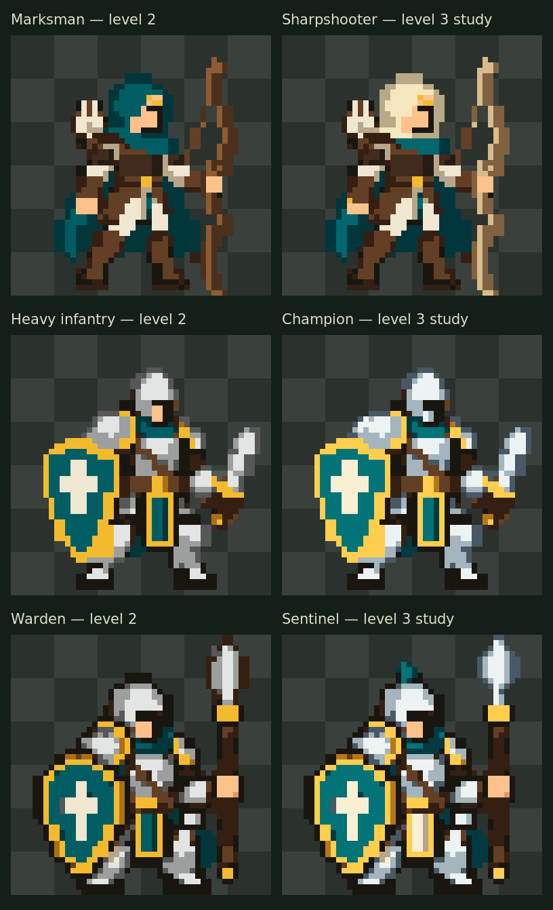

# Human level-three studies

Bright equipment variants of the current level-two human units. These are
finished image sources in `art/pixel/units/`, with no new gameplay registration
or stats. This folder keeps construction code and comparison boards.

- `../../units/sharpshooter/`: cream hood, teal cloak, pale wooden bow and a gold-edged
  leather bracer. Derived from Marksman.
- `../../units/champion/`: bright silver plate and gold trim, a closed helmet with a narrow
  visor and a broader shield-side pauldron. Derived from Heavy infantry.
- `../../units/sentinel/`: silver armor, an ivory tabard, a teal helmet crest and a clean
  leaf-shaped steel spearhead. Derived from Warden.
- `../../units/grand-marshal/`: three-point gold coronet, bright gold fittings and mantle
  trim, and a pale cyan crystal sword. Derived from Marshal; both factions saved.
  [Commander progression](commander-preview.png).

Each folder contains a 48×48 matrix, a flat RGBA palette and its transparent PNG.
The comparison shows the existing level-two unit on the left and its proposed
level-three variant on the right. Original game matrices remain separate.

