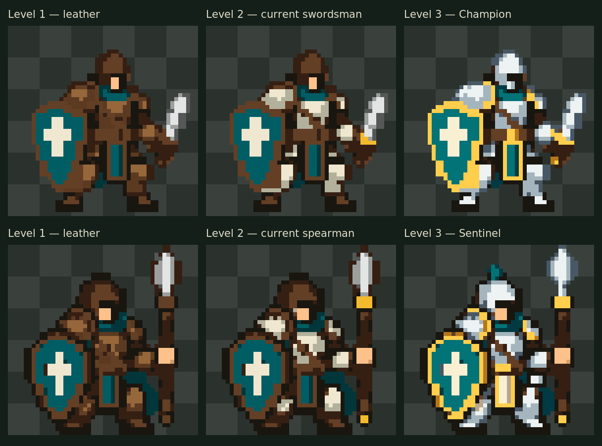

# Infantry progression study

A leather → mixed equipment → silver plate artwork progression for both human
infantry branches. Finished sources live in `art/pixel/units/`; gameplay
definitions are unchanged. This folder keeps the comparison board.

- Level one: new leather variants of Swordsman and Spearman. Armor panels use
  warm leather colors, shield crosses remain painted ivory, and weapons retain
  steel blades. Weapon fittings use plain leather/wood colors instead of gold.
- Level two: the current level-one Swordsman and Spearman artwork.
- Level three: the silver Champion and Sentinel candidates in `../human-level3/`.

The two new variants have transparent 48×48 matrices, explicit RGBA palettes and
rendered PNGs. Their silhouettes and poses match their source units.

