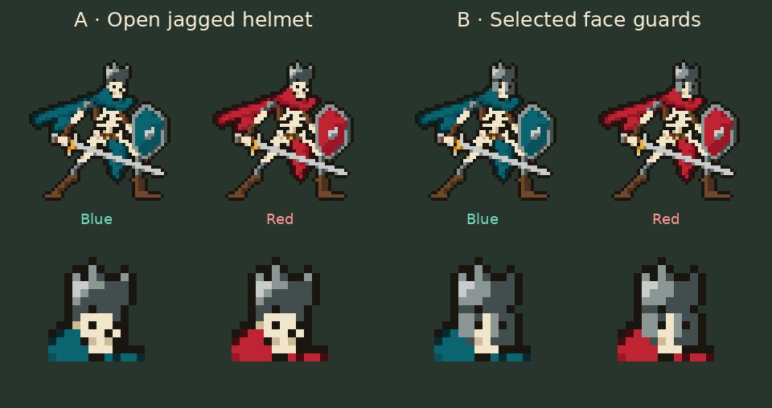

# Revenant helmet alternatives

Level-two skeleton warrior studies; level one remains bareheaded.
Both variants use the same jagged iron crown, veteran body and faction geometry.

- **A — Open:** the skull face is exposed beneath the broken crown and brow rim.
- **B — Guarded:** connected temple/cheek plates and a narrow nose guard cover
  parts of the face. The dark sockets and bone teeth remain visible.

Each folder contains editable 48×48 faction matrices, the palette and native
PNGs. The guarded version is selected for the game, with connected steel planes
lit from the upper left. The open version remains an alternative reference.

