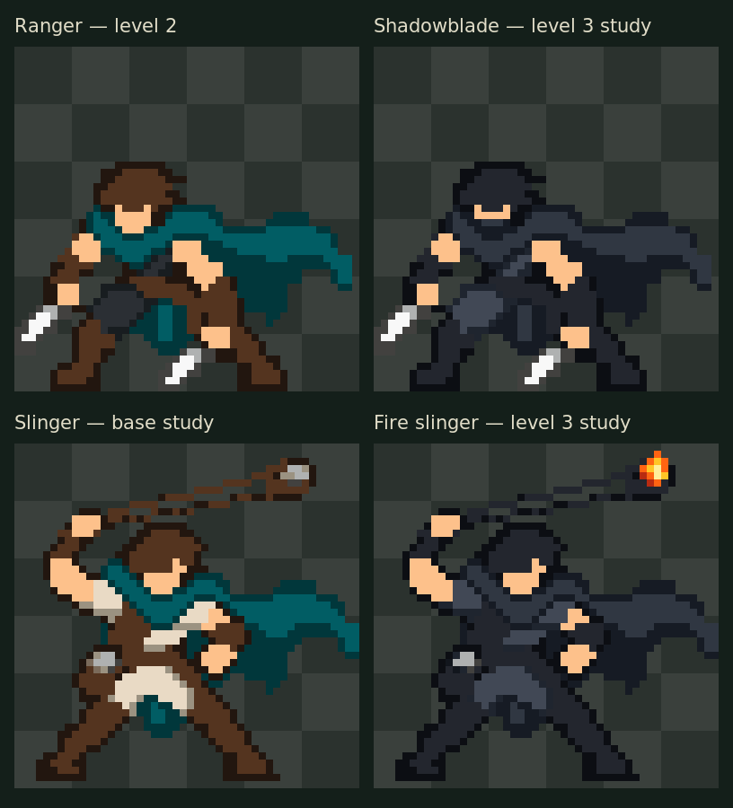

# Scout level-three studies

Palette variants of the current Ranger and Slinger, preserving their poses.
Finished sources live in `art/pixel/units/`, with no new gameplay registration
or stats. Comparison boards remain here.

- `../../units/shadowblade/`: charcoal clothing and leather, with a lower-face mask.
- `../../units/fireslinger/`: charcoal clothing and leather, with an orange-yellow burning
  projectile in the sling. The projectile has a small connected flame.

Each folder contains an editable 48×48 matrix, an explicit flat RGBA palette,
and its rendered transparent PNG. The current level-two Ranger and base Slinger
remain separate source designs.

