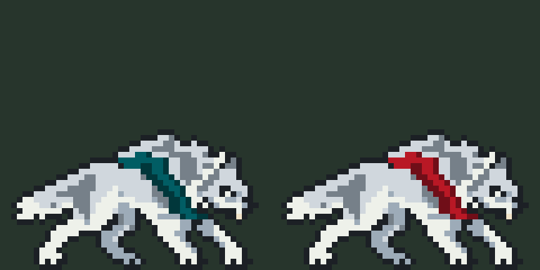

# White wolf reference

Saved white-coated dire wolf variant, approved for keeping as a reference.
Candidate for a special unit in a future campaign.

The editable 48×48 `player.txt` and `enemy.txt` matrices share the approved
wolf anatomy and integrated back fur. `palette.json` defines the pale coat,
cool grey shadows, dark outline and faction cloth. Native renders are
`player.png` and `enemy.png`; `preview.png` shows both at 8× nearest-neighbor.

The playable dire wolf uses its selected dark coat. This reference has no unit
registration or balance stats yet.

