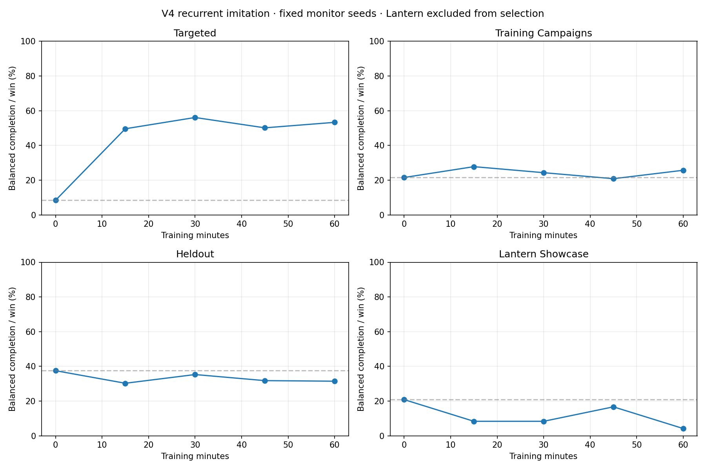
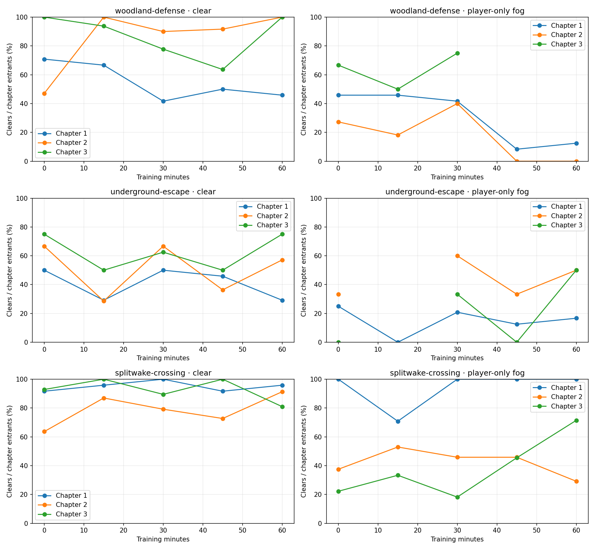
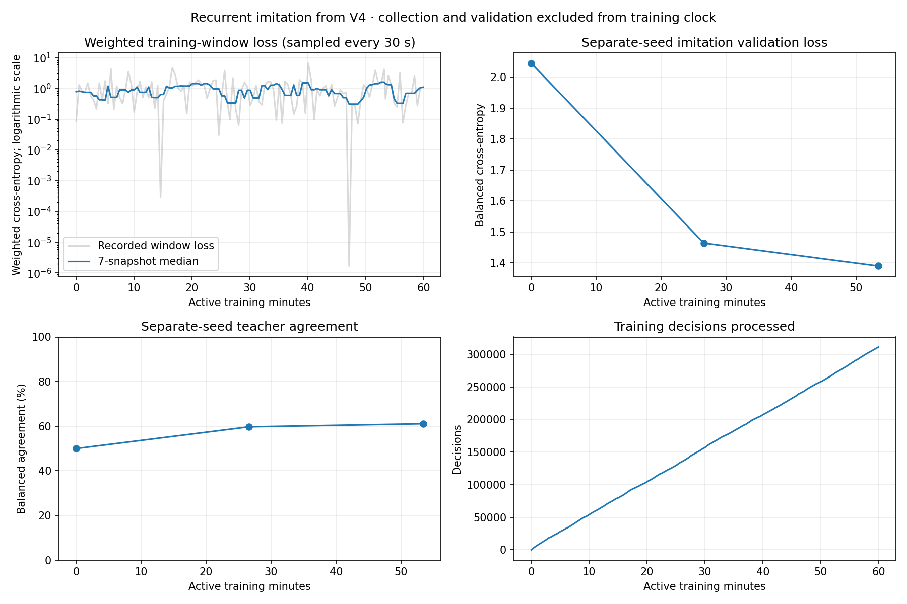
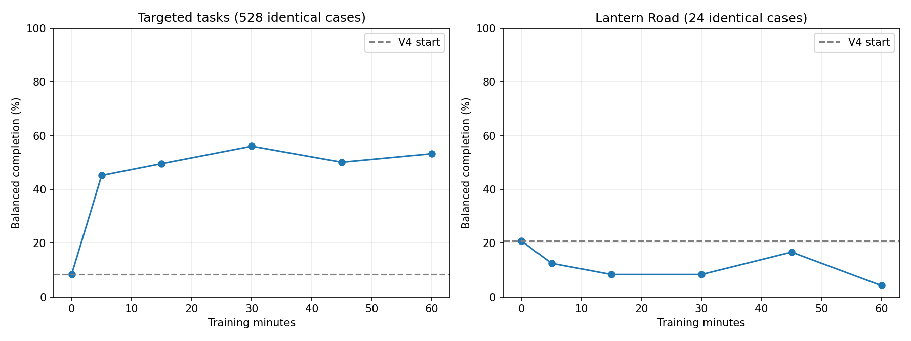

# Recurrent imitation from V4

Completed 60.00 active training minutes; 40,283 updates and 311,262 decisions.
Monitor-best trained checkpoint: **minute-0030**. Recorded confirmation selection: **minute-0030**.

Balanced completion/win scores on independent confirmation seeds:

| Set | V4 | 30-minute imitation | Cases each | Gained / lost V4 successes |
|---|---:|---:|---:|---:|
| targeted | 8.53% | 55.70% | 1320 | 773 / 24 |
| training_campaigns | 24.72% | 20.56% | 360 | 40 / 55 |
| heldout | 32.49% | 29.84% | 1296 | 142 / 181 |
| lantern_showcase | 8.33% | 3.33% | 60 | 2 / 5 |

Lantern Road is a separate showcase and does not influence selection. Balanced scores use within-set group weights and are not the raw total win fraction.

The targeted gain generalizes to fresh combat seeds. Broader task changes must be assessed separately; a higher combined selection score is not evidence that every campaign or held-out setting improved.

The recorded mixed-score selection gives two thirds of its weight to training maps on separate seeds. It does not establish the strongest general policy. Independent confirmation shows regressions on broad campaigns, held-out gameplay and Lantern Road despite the targeted gain. No default policy was promoted.

The recovery inventory records original hashes and gzip restore paths. All five-minute native policies and Torch resume states are retained. The large teacher corpus remains in the shared run backup, outside Git.

## Five-minute follow-up

Exact same 528 targeted and 24 authored Lantern cases, evaluated after the original run.

| Behavior family | V4 | 5 minutes | 30 minutes |
|---|---:|---:|---:|
| deadline | 2.1% | 47.9% | 83.3% |
| routes | 0.0% | 0.0% | 4.2% |
| escort-handoff | 13.9% | 100.0% | 100.0% |
| defend | 21.5% | 42.1% | 31.2% |
| interrupt | 8.3% | 45.8% | 45.8% |
| joint-attack | 12.5% | 72.2% | 63.2% |
| breakthrough | 8.3% | 12.5% | 62.5% |
| ranged-melee | 0.5% | 41.2% | 58.6% |

Five-minute targeted score: **45.22%**, 243/528 raw successes; Lantern: **3/24**.
The family-balanced score is not the raw win fraction. Eight Lantern cases per opponent make small differences noisy.

