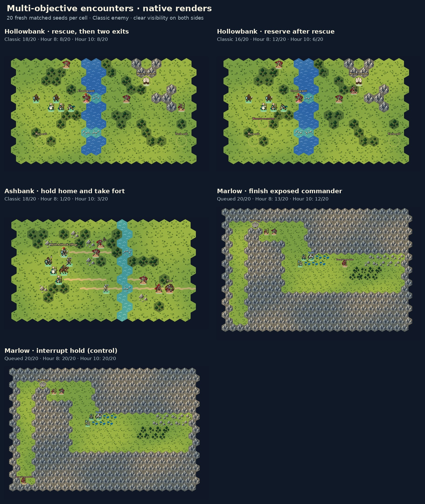

# Fog scopes and multi-objective encounter validation

Three Sol workers built, simulated and traced multi-objective encounters. Earlier commander and route fixtures were independently checked under player-only and both-sides returning fog. These are isolated experiments; no playable catalog, RL workload, reward, sampling or checkpoint promotion changed.

## Multi-objective confirmation

Each cell uses 20 fresh matched seeds, fixed authored forces, no recruits, clear visibility on both sides and an active Classic opponent. Hour8 and Hour10 are frozen checkpoints from the completed PPO experiment. Full, Queued and Classic columns are alternative player controllers against that same enemy.

| Encounter | Task | Hour8 | Hour10 | Full | Queued | Classic |
|---|---|---:|---:|---:|---:|---:|
|Hollowbank east-road guard|Capture → rescue → two separate living exits|8/20|8/20|14/20|18/20|18/20|
|Hollowbank west-bank reserve|Same sequence, enemy reserve arrives after rescue|12/20|6/20|10/20|12/20|16/20|
|Ashbank Relay, fork-vigil|Hold staffed home village ten consecutive rounds AND capture/retain east fort|1/20|3/20|12/20|10/20|18/20|
|Marlow Cut, finish|Choose exposed commander kill over contested post|13/20|12/20|20/20|20/20|20/20|
|Marlow Cut, interrupt control|Commander distant: interrupt enemy's six-round hold|20/20|20/20|19/20|20/20|20/20|

Hollowbank: Hour10 captures in20/20, rescues in17/20, then wins8/17 entered extraction attempts in the east-road variant. Three failures stall at rescue; nine hit the extraction deadline. A matched trace shows the commander remaining at the captured post after all enemies are dead while the rescued actor already reached her exit. All200 accepted-condition replays physically verify both living actors on their respective exits in every victory.

Ashbank: Hour10 captures the forward fort in20/20 but loses the home village in17/20. Classic captures in20/20 and loses home in only2/20. Its18 wins split forces across both fronts. Every Classic attempt takes direct damage at the village; this is active defense, not merely waiting for a timer. Any player troop may staff the village. The forward capture deadline is round7; home staffing/ownership must remain uninterrupted for ten rounds and both sites must be owned at victory. Do not describe this experiment as proof of learned guard rotation.

Marlow: Queued changes its opening toward the post or toward the exposed commander according to the start. Both learners instead send the knight toward the post in every opening in both starts. In Finish, all learner victories are by territory, while all reference victories defeat the commander on rounds2–3. A post-first plan can still win; the gap is recognizing the earlier, safer option. The native observation shows the public enemy countdown decreasing and resetting after capture. This is a true arena with alternative victory routes; the others are scripted single-stage encounters.

## Fog qualification

[Full fog matrix and native visibility audit](fog/README.md). Blocked-road Scree remains a strong gap under both player-only and both-sides fog: both learners0/20, Full and Classic20/20. Healthy commander player-only fog: Hour10 4/20 versus Queued18/20. Wounded+healer player-only fog: both learners0/20 versus Queued15/20. Healthy commander both-fog is rejected as a reference-gap task: references also fail. Wounded+healer both-fog is only a harder diagnostic (Full10/20), not a reliably solved reference task.

Multi-objective confirmed results above are clear-only. Hollowbank player-fog screening failed reference solvability (Classic2/8), so it was not advanced to confirmation. No multi-objective both-fog qualification is claimed.

## Evidence and limits

- Fog: 900 commander +480 route confirmation games, all with in-game outcomes and zero caps;114 detailed matched replays.
- Multi-objective: 800 pressure/final confirmation games independently recounted by the parent, including rejected conditions;700 detailed matched replays (200 Hollowbank accepted,300 Ashbank pressure,200 Marlow). Earlier Ashbank tuning confirmations and discovery are also preserved, separate from the800-game audit.
- Multi-objective seeds: Hollowbank493021001–020; Ashbank571239001–020; Marlow661135201–220. Discovery uses separate seeds. Native/model identities, exact configurations, catalogs, raw results and terminal/objective evidence are in each family folder.
- Rejected or weaker controls remain archived: Hollowbank two-bank reserves, Ashbank timing-only and overly hard pressure variants, and mastered Marlow Interrupt.
- Twenty seeds on fixed geometry establish a reproducible encounter gap, not unseen-layout generalization or proof that training on it will transfer. No training was performed.
- Native artwork previews and render inputs are preserved. Render-only connection metadata/header changes do not alter evaluated gameplay catalogs.

