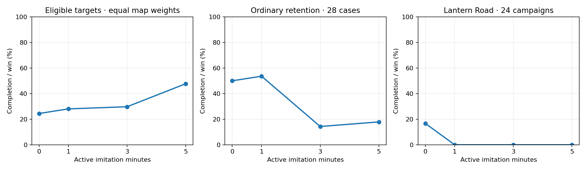
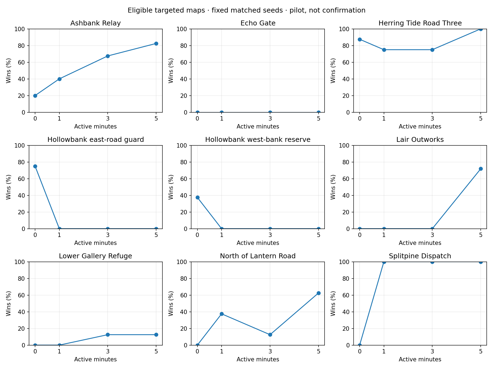
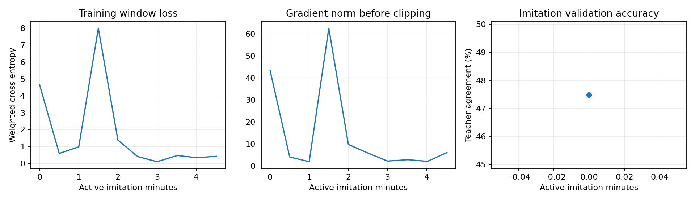

# Five-minute eligible-only imitation trial

Completed from the final hour-10 PPO actor, without changing architecture or
starting PPO. Saved checkpoints at requested 1/3/5 active minutes; all are retained
with their optimizer/RNG/recurrent training state. No model was promoted.

## Matched gameplay results

| Active minutes | Eligible targets | Ordinary retention | Lantern Road | Target score, equal map weights |
|---|---:|---:|---:|---:|
| 0 | 24/128 | 14/28 | 4/24 | 24.4% |
| 1 | 33/128 | 15/28 | 0/24 | 28.1% |
| 3 | 43/128 | 4/28 | 0/24 | 29.7% |
| 5 | 78/128 | 5/28 | 0/24 | 47.7% |

The target column counts individual wins. The overview curve gives each of the
nine logical maps equal weight, so it differs from raw wins/128. All four
checkpoints use identical cases. 0 is the unmodified hour-10 baseline.

The five-minute model learned several targeted situations: Splitpine 0→8/8,
Lair 0→23/32, Ashbank 8→33/40, North of Lantern Road 0→5/8. Echo remains 0/8,
Lower Gallery improves only 0→1/8, and the two Hollowbank starts regress 9→0/16.
Retention worsens: ordinary arenas 14→5/28 and Lantern 4→0/24. These are real
native gameplay comparisons, not teacher-agreement scores. This run therefore
does not establish a generally stronger policy or justify promotion.

Caps are reported separately in raw summaries: targets 0 at every checkpoint;
ordinary 0/2/4/2 and Lantern 7/14/22/22 at 0/1/3/5 minutes. A cap is unresolved,
not proof of a particular idle/route/combat failure. No new action traces were
collected to assign causes to these regressions.

## Frozen training protocol

- Source revision 74497cc; frozen Python, native module, catalog and workload.
- Exactly 600 eligible training and 100 imitation-validation games, 25 configured
  recruiter/condition groups spanning 16 enemy/visibility conditions and 9 maps.
  No disabled target, ordinary arena or broad campaign supplies imitation labels.
- Initial actor exactly reproduces hour10's native model JSON. The baseline also
  matches all 24 historical Lantern outcomes and chapter results exactly.
- Existing ordered recurrent imitation: sequence length 8, sequence batch 1,
  two Torch threads, fresh Adam at 1e-4, gradient clipping 1. All CNN, coarse,
  GRU and head parameters remain trainable; measured changes are in analysis.json.
- 300 active training-pipeline seconds exclude collection, initial validation,
  checkpoint writes and recovery downtime. Per-checkpoint actual saved times are
  in checkpoint-index.json. No checkpoint was selected using teacher loss.
- The trainer made 2,588 optimizer updates across 19,729 decisions. Collection
  contains 40,898 teacher decisions. Training wall time was about 14.5 minutes,
  including corpus collection and initial validation; gameplay checks ran alongside.
- A watchdog mirrored complete shards/checkpoints to shared storage. Startup
  supervision had an interpreter-path error and a snapshot race on a worker's
  temporary file; both were corrected. The original trainer process continued
  without restart throughout; its workload, optimizer and budget were unchanged.

## Gameplay scope and limits

Targeted panel: 8 fresh seeds per eligible enemy/visibility condition, one
configured recruiter,128 games/model. It covers player-only and both-sides fog
as explicitly authored. Ordinary retention: 14 maps × 2 fresh seeds, Human against
Skeletons, deathmatch, player first, 28 games/model. Lantern: the unchanged 24-case
authored historical showcase, with authored visibility and enemy blocks.

This is a small fixed-layout pilot, not an independent statistical confirmation,
unseen-map generalization test or full faction/initiative/broad-campaign audit.
Training used each condition's configured recruiter pool; gameplay probes one
configured recruiter per condition. Neither gameplay panel supplies gradients.

## Artifacts

- analysis.json: map, condition, paired-case and chapter-conditional results,
  actual checkpoint times and parameter changes.
- evaluation: all 720 raw native matches and summaries.
- recovery: baseline plus 1/3/5-minute model/state bundles, compressed losslessly;
  checkpoint-index.json records hashes and original paths.
- protocol.json, frozen eligibility, workload and corpus manifests preserve
  source/teacher/seed/fingerprint provenance. Full corpora and native/Python
  snapshots remain in the local/shared run directory named by the protocol paths.
- trainer/metrics logs preserve training progress; no training loss is presented
  as gameplay strength. Evaluation/archival scripts are historical experiment
  sources, not a new production training implementation.

